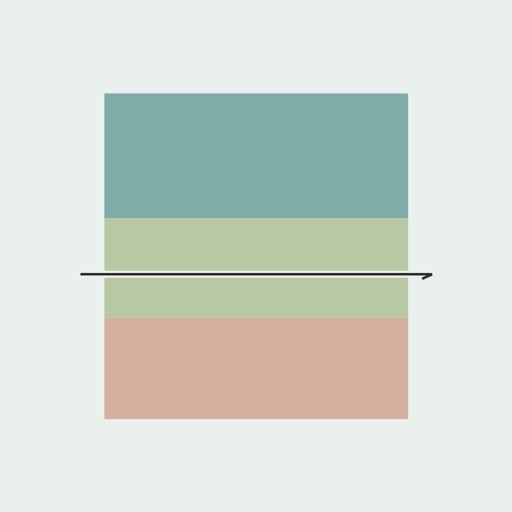
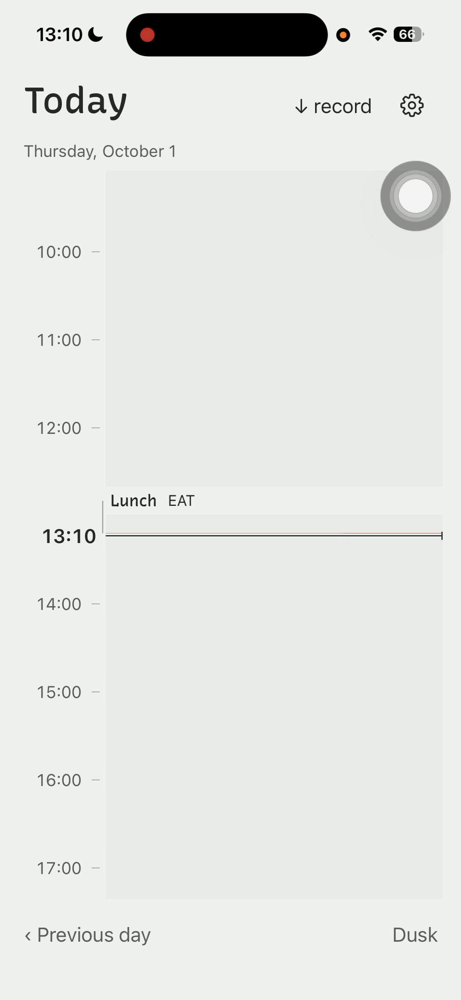
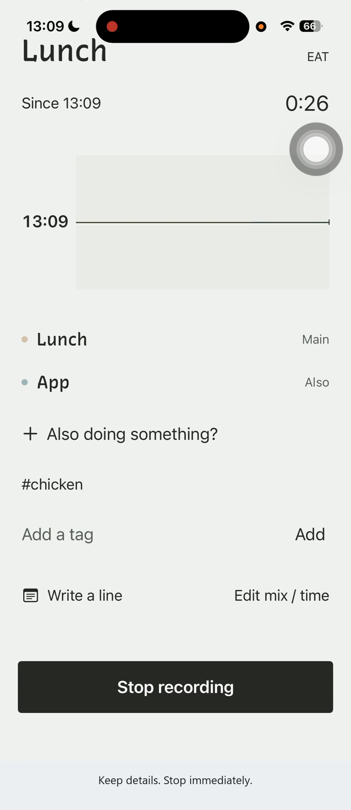
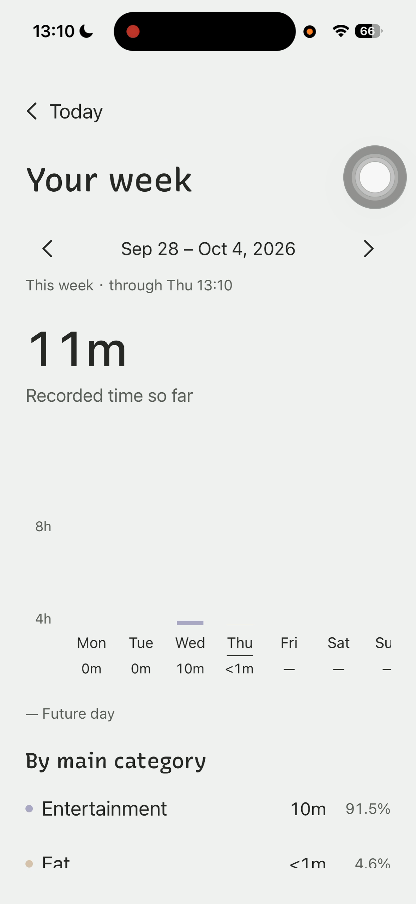
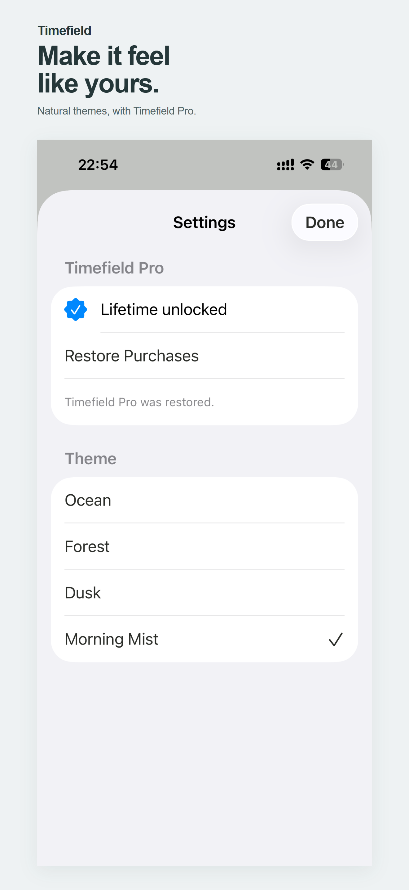

  

<h1 align="center">Timefield</h1>

<strong>A low-friction visual time tracker.</strong>

  Native iOS · Available on the App Store 
  Designed and independently developed by <a href="https://github.com/annikazhang77">Annika Zhang</a>

  <a href="https://apps.apple.com/us/app/timefield/id6817741175">Download on the App Store</a> ·
  <a href="https://annikazhang77.github.io/timefield-support/">Support</a> ·
  <a href="https://annikazhang77.github.io/timefield-support/privacy.html">Privacy Policy</a>

---

Timefield gives a blurry day a visible shape. Record an activity, let overlapping activities belong to the same moment, and return to a colored timeline of what actually happened.

Built for everyday life, creative work, and quiet reflection—with room for gaps and changes of plan.

  
  
  

Today → record overlapping activities → reflect on the week. Actual iPhone captures from the release-era Build 2 demo. <a href="MEDIA.md">Image sources</a>

## A day, at your pace

- **Capture the present.** Start and stop an activity, or use Apple Shortcuts to get into recording more quickly.
- **Keep life together.** Record up to five simultaneous activities, select a main activity, and count the elapsed time once.
- **Leave useful details.** Add optional notes and tags; fill a missed gap or adjust a time to the minute.
- **Look back gently.** Browse your daily history without productivity scores or streaks. Blank time can stay blank.
- **See the bigger picture.** Optional Timefield Pro adds seven-day insights, main-category breakdowns, and additional natural themes through a one-time lifetime purchase. Recording and daily history remain free.

No account is required. Time records are stored on the device; purchase processing is described in the [Privacy Policy](https://annikazhang77.github.io/timefield-support/privacy.html).

## Designed around real life

The central design decision is to make time visible without turning it into a performance score. Color and duration give the day its structure; optional detail stays secondary to the act of recording.

Mixed activities share one interval instead of inflating the total. Daily history stays accessible in the free experience, while weekly reflection is a separate, optional layer.

This independent product brings together interaction design, native implementation, on-device persistence, purchase integration, and an App Store release.

## Built with

| Layer | Implementation |
| :--- | :--- |
| App | Swift and SwiftUI; iPhone, iOS 16+ |
| Data | Local JSON persistence in the app's Application Support directory |
| Quick capture | App Intents and Apple Shortcuts |
| Purchases | RevenueCat's iOS SDK for the lifetime Pro entitlement |
| Delivery | Xcode and App Store Connect |

## Get Timefield

**[Download Timefield on the App Store →](https://apps.apple.com/us/app/timefield/id6817741175)**

[Support](https://annikazhang77.github.io/timefield-support/) · [Privacy Policy](https://annikazhang77.github.io/timefield-support/privacy.html) · [Developer](https://github.com/annikazhang77)

Current App Store artwork

---

Product showcase for a commercial app. The application source code is private. Product screenshots and branding remain the property of their respective owners. See <a href="MEDIA.md">media provenance</a>.
